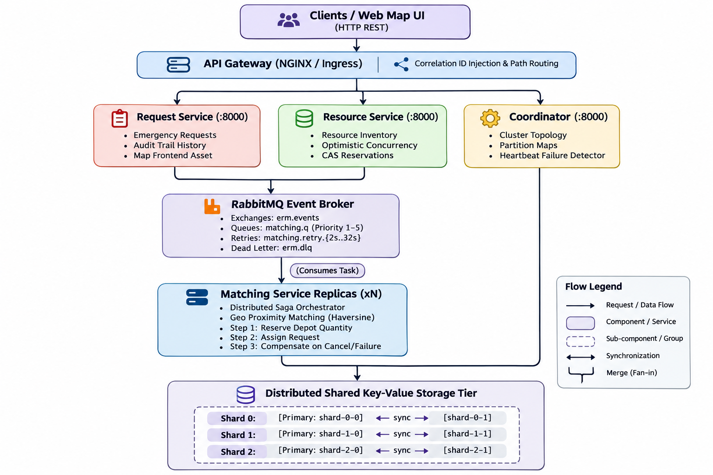

# Distributed Emergency Resource Matching System

**Authors:**  
Harsh Mohta (`IMT2023106`) &middot; Sarthak Maheshwari (`IMT2023014`)  
*Course: Cloud Computing &mdash; International Institute of Information Technology, Bangalore (IIIT-B)*

**GitHub:** <https://github.com/SartMa/Emergency-Response-System>
**Project report:** [`Project_Report.pdf`](Project_Report.pdf)

### Branches

| Branch | What it contains |
|---|---|
| **`main`** | The complete project: microservices, sharded storage tier, tests, chaos harness, Docker Compose and Kubernetes (Minikube) deployment. |
| **`feature/cloud`** | Everything in `main` **plus** the `ansible/` directory (Ansible playbook + k3s) that deploys the system to a cloud VM with one command (`make cloud-deploy`). |

---

## 1. Project Overview

The **Distributed Emergency Resource Matching System** is a cloud-native, fault-tolerant platform built to coordinate disaster relief operations in real time. During emergencies (such as floods, earthquakes, or industrial crises), affected individuals and field coordinators submit urgent requests for essential supplies (drinking water, food packets, emergency medicines, evacuation transport, and temporary shelter). Simultaneously, NGOs, registered volunteers, and regional supply depots register available resources with specific quantities and geographic coordinates.

The system solves the critical challenge of **asynchronous, low-latency, zero-over-allocation resource distribution**:
- Matches requests asynchronously to the **nearest available resource with sufficient quantity** using great-circle (Haversine) calculations.
- Enforces strict **optimistic concurrency control (OCC)** to prevent over-allocation and double-booking even under concurrent load spikes.
- Employs a **distributed saga pattern** with automated compensation (returning allocated capacity upon cancellation or upstream failure).
- Operates atop a **custom sharded, replicated, self-healing distributed key-value storage tier** that guarantees high availability and zero data loss across node failures.
- Offers end-to-end containerized and orchestratable deployment with **Docker, Docker Compose, and Kubernetes (Minikube)**.

---

## 2. Architecture & High-Level Flow



*Figure 1: Clients reach the API gateway; the Request, Resource and Coordinator services sit behind it. Requests are queued in RabbitMQ, matched by competing Matching Service replicas through a saga, and persisted in the sharded, replicated key-value storage tier.*

### End-to-End Request Lifecycle
1. **Request Intake**: A client posts an emergency request (`POST /requests`) with item type, quantity, urgency (1–5), and lat/long coordinates.
2. **Persistence**: The Request Service queries the Coordinator for the partition mapping and persists the record to the appropriate primary storage shard.
3. **Async Queueing**: An event is published to RabbitMQ's priority queue (`matching.q`). Critical medical needs (urgency 5) jump ahead of low-urgency queries.
4. **Saga Execution**:
   - A `matching-service` worker consumes the message.
   - Evaluates eligible resources using the configured strategy (`nearest` via Haversine distance, or `balanced` to spread load).
   - **Step 1 (Reserve)**: Calls Resource Service to lock quantity via optimistic compare-and-swap (CAS).
   - **Step 2 (Assign)**: Calls Request Service to mark the request `ASSIGNED` with resource ID and distance.
   - **Compensating Action**: If assignment fails or a user cancels an assigned request (`PUT /requests/{id}/status`), the saga triggers a release command returning the reserved quantity to the depot.
5. **Auto-Retry & Wake-Up**: Unmatched requests wait in TTL retry queues. When new inventory is registered or released, a wake-up event triggers re-matching.

---

## 3. Major Components & Technologies

| Component / Tool | Role in Project | Implementation Details |
|---|---|---|
| **Docker & Docker Compose** | Microservice Containerization & Local Dev | One unified `Dockerfile` (`python:3.12-slim` + `uv`, non-root user) parameterised by the `SERVICE` build argument, sharing `services/common`. The full 12-service topology (RabbitMQ, coordinator, 6 storage nodes, 3 application services, gateway) starts with a single command. |
| **Kubernetes (Minikube)** | Container Orchestration & Production Clustering | Declarative manifests under `k8s/`: Deployments, StatefulSets (storage & RabbitMQ), Ingress (NGINX controller), Services, PersistentVolumeClaims, and ConfigMaps. |
| **Horizontal Pod Autoscaling (HPA)**| Dynamic Load Balancing | Scales `matching-service` pods dynamically (from 2 up to 5 replicas, target 50% CPU) based on utilization metrics gathered via `metrics-server`. |
| **Jenkins & CI/CD** | Automated Pipeline | Automates linting, unit test execution, image building, integration smoke tests, and deployment verification. |
| **Ansible** *(branch `feature/cloud`)* | Infrastructure as Code & Config Management | Playbook `ansible/site.yml` with four idempotent roles: `common` (Docker, packages, firewall), `k3s` (single-node Kubernetes with Traefik, metrics-server and local-path storage), `app` (ships the committed code, builds the 5 images on the VM, generates the RabbitMQ password, applies `k8s/`) and `smoke_test` (checks the public IP). Run with `make cloud-deploy`. |
| **Cloud Computing Principles** | Distributed Systems Resiliency | Implements 12-factor cloud principles, stateless compute services, shared-nothing sharded persistence, failure isolation domains, and graceful degradation. |
| **RabbitMQ Message Broker** | Asynchronous Event Streaming & Prioritization | Priority queues (`x-max-priority: 5`), dead-letter queues (`erm.dlq`), and per-delay backoff queues (`matching.retry.2s` through `32s`) preventing head-of-line blocking. |
| **Custom Sharded Storage Tier** | Scalable Key-Value Core | Keys are hashed with SHA-1 into 12 fixed partitions that map onto 3 shards (re-balancing moves whole partitions only). Single-leader replication per shard, versioned SQLite (WAL mode) stores, automated heartbeat failure detection and zero-data-loss failover. |
| **Coordinator Node** | Cluster Metadata & Health Manager | Central heartbeat receiver (`/internal/heartbeat`), cluster view aggregator, failover arbiter, and host of the real-time operational dashboard. |
| **Leaflet & OpenStreetMap Web UI**| Interactive Operations Frontend | Single-page real-time dashboard served directly by the gateway (`/`), rendering live resources, emergency requests, status filters, and dispatch lines. |

---

## 4. Project Structure

```text
Emergency-Response-System/
├── deploy/
│   └── gateway/
│       └── nginx.conf              # NGINX reverse-proxy routing for Docker Compose
├── k8s/                            # Kubernetes deployment manifests
│   ├── 00-namespace.yaml           # Namespace: erm
│   ├── 01-config.yaml              # Cluster ConfigMap (endpoints, timeouts)
│   ├── 10-rabbitmq.yaml            # RabbitMQ StatefulSet + Management Service
│   ├── 20-coordinator.yaml         # Coordinator Deployment + Service
│   ├── 30-storage.yaml             # Storage Shards 0..2 StatefulSets & PVCs
│   ├── 40-services.yaml            # Request, Resource, Matching Deployments
│   ├── 50-ingress.yaml             # Ingress-NGINX rules (/requests, /resources, /match)
│   └── 60-hpa.yaml                 # HorizontalPodAutoscaler for matching-service
├── docs/
│   ├── architecture.png            # System architecture / flow diagram
│   └── report/Project_Report.html  # Source of Project_Report.pdf
├── scripts/
│   ├── chaos.py                    # Automated chaos testing suite (fault injection)
│   ├── ui_e2e.py                   # End-to-end browser workflow verification
│   └── demo/                       # Live demonstration shell scripts (00 to 10)
├── services/                       # Application microservices source code
│   ├── common/                     # Shared models, AMQP helpers, errors, storage client
│   ├── coordinator/                # Failure detection, heartbeats, partition maps, dashboard
│   ├── matching_service/           # Saga orchestration, Haversine geo-matching strategies
│   ├── request_service/            # Request domain logic, audit trail, landing page UI
│   ├── resource_service/           # Resource registry, optimistic concurrency reservation
│   └── storage_node/               # Versioned SQLite (WAL) store, single-leader sync, delta catch-up
├── tests/
│   ├── unit/                       # Fast isolated unit tests (domain, sagas, routers)
│   └── integration/                # End-to-end cluster integration tests
├── .env                            # Machine-specific environment overrides (e.g. GATEWAY_PORT)
├── docker-compose.yml              # Complete 12-service local orchestration
├── Dockerfile                      # Unified container image build specification
├── Makefile                        # Convenience targets (make up, test, chaos, k8s-*)
├── Project_Report.pdf              # Project report
└── pyproject.toml                  # Python 3.12 project metadata and dependencies
```

> **Cloud deployment:** the `ansible/` directory (playbook, roles, inventory template) and `scripts/cloud-tunnel.sh` exist only on the **`feature/cloud`** branch. See [Option C](#option-c-cloud-deployment-with-ansible-branch-featurecloud).

---

## 5. API Specification

Interactive Swagger API docs are available at `/docs` on each individual service.

### Public Client Endpoints

| Method | Endpoint | Purpose | Success Code |
|---|---|---|---|
| **POST** | `/requests` | Create emergency request (lat/lon, type, urgency 1–5, quantity) | `201 Created` |
| **GET** | `/requests/{id}` | Retrieve request details, assignment, distance, and audit history | `200 OK` |
| **GET** | `/requests` | List requests (filterable by `status`, `type`, with `limit` support) | `200 OK` |
| **PUT** | `/requests/{id}/status` | Update status (`IN_PROGRESS`, `FULFILLED`, `CANCELLED` &rarr; triggers compensation) | `200 OK` |
| **POST** | `/resources` | Register resource depot (name, location, capacity quantity, type) | `201 Created` |
| **GET** | `/resources/{id}` | Retrieve resource details, remaining quantity, and active allocations | `200 OK` |
| **GET** | `/resources` | List resources (filterable by `type`, `status`) | `200 OK` |
| **PUT** | `/resources/{id}/status`| Update status (toggle online/offline, restock inventory) | `200 OK` |
| **POST** | `/match/{requestId}` | Trigger manual on-demand matching evaluation | `200 OK` |

### Internal Cluster & Diagnostics Endpoints

| Method | Endpoint | Purpose |
|---|---|---|
| **GET** | `/internal/cluster` | Live node health (`ALIVE`, `SUSPECT`, `DEAD`), sync status (`IN_SYNC`, `STALE`), partition maps |
| **GET** | `/internal/queues` | RabbitMQ queue metrics (waiting messages, consumers, processing rates) |
| **GET** | `/internal/locate/{key}` | Inspect partition hashing: resolves entity key &rarr; partition number &rarr; shard ID &rarr; node URLs |
| **GET** | `/internal/verify` | Cryptographic data consistency verification: compares primary vs replica digests per shard |
| **GET** | `/dashboard` | Coordinator web dashboard visualizing cluster topology and live health |

Standardized Error Format:
```json
{
  "error": {
    "code": "CONFLICT",
    "message": "Resource quantity modified concurrently",
    "correlation_id": "c92a7f8041"
  }
}
```

---

## 6. Project Setup & Quick Start

### Option A: Local Development (Docker Compose)
*No Kubernetes, Minikube, or Ansible required. Works on Windows, macOS, and Linux.*

1. **Start all services**:
   ```bash
   # Windows (PowerShell / Command Prompt):
   docker compose up -d --build

   # Linux / macOS (or with make):
   make up
   ```
2. **Access Web Interfaces**:
   - **Interactive Web App & Map**: [http://localhost:8080](http://localhost:8080) *(or port `8085` if configured in `.env`)*
   - **Cluster Health Dashboard**: [http://localhost:8090/dashboard](http://localhost:8090/dashboard)
   - **RabbitMQ Management**: [http://localhost:15672](http://localhost:15672) (`guest` / `guest`)
3. **Verify API with Sample Traffic**:
   ```bash
   # Register a water tanker depot
   curl -X POST http://localhost:8080/resources -H 'Content-Type: application/json' \
     -d '{"type":"water","name":"Bandra Depot","quantity":50,"location":{"lat":19.06,"lon":72.83}}'

   # Submit an urgent water request
   curl -X POST http://localhost:8080/requests -H 'Content-Type: application/json' \
     -d '{"type":"water","quantity":5,"urgency":5,"location":{"lat":19.076,"lon":72.878}}'

   # Fetch request by ID -> Status transitions asynchronously to ASSIGNED
   curl http://localhost:8080/requests/<REQUEST_ID>
   ```
4. **Stop and Clean Up**:
   ```bash
   docker compose down -v
   ```

---

### Option B: Kubernetes Deployment (Minikube)

1. **Start Minikube with required addons**:
   ```bash
   minikube start --cpus=4 --memory=6g
   minikube addons enable ingress
   minikube addons enable metrics-server
   ```
2. **Build and load container images**:
   ```bash
   make k8s-build
   ```
3. **Deploy cluster manifests**:
   ```bash
   make k8s-deploy
   make k8s-status
   ```
4. **Expose ports**:
   ```bash
   make k8s-gateway    # Exposes Ingress on localhost:8080
   make k8s-dashboard  # Exposes Dashboard on localhost:8090/dashboard
   make k8s-rabbitmq   # Exposes RabbitMQ on localhost:15673
   ```

---

### Option C: Cloud Deployment with Ansible (branch `feature/cloud`)

The Ansible playbook lives on the `feature/cloud` branch (it contains all of `main` plus the `ansible/` directory).

```bash
git checkout feature/cloud
cp ansible/inventory.ini.example ansible/inventory.ini   # put the VM's public IP in it
make cloud-deploy                                        # k3s + images + manifests, ~10 min first time
make cloud-tunnel                                        # control the cloud cluster from your laptop
```

Requirements: a fresh Ubuntu 22.04/24.04 VM with ports 22 and 80 open (Oracle Cloud Always Free works). Details in `ansible/README.md` on that branch.

---

### Option D: Running Test Suites
```bash
# Run isolated unit tests
pytest tests/unit -q

# Run full integration tests against running stack
GATEWAY_URL="http://localhost:8080" pytest tests/integration -q

# Run Chaos Engineering Suite (2 minutes of continuous traffic + random storage node kills)
python scripts/chaos.py --mode compose --report chaos-report.json
```

---

## 7. Our Innovations, Extensions & Flaws Resolved

The project extends significantly beyond the original basic course specification. Below is a comprehensive breakdown of the architectural additions, identified design flaws, and engineering solutions implemented.

### 7.1 Key Additions Beyond the Problem Statement

1. **Geographic Proximity Matching**:
   - *Problem in Spec*: The basic specification assumed matching was based on raw string equality for locations.
   - *Our Implementation*: Real-world coordinate model (`lat`/`lon`). Implemented great-circle distance calculation using the **Haversine formula**. Matching ranks available resources by physical distance within a configurable radius (`MAX_RADIUS_KM`). Built using the **Strategy Pattern** supporting both `nearest` and `balanced` (load-spreading) heuristics.
2. **Urgency-Based Prioritization**:
   - *Our Implementation*: Requests carry an urgency rating from 1 (low) to 5 (critical emergency). Integrated with RabbitMQ priority queues (`x-max-priority: 5`). Critical life-saving requests (e.g. ICU oxygen, emergency medicine) bypass backlogged general inquiries.
3. **Capacity Quantity & Zero Over-Allocation**:
   - *Problem in Spec*: Binary 1-to-1 matching without tracking inventory remaining.
   - *Our Implementation*: Resources carry total and remaining quantities. A request specifies needed volume. Concurrency control uses optimistic record versioning (`version` counter + `If-Match` headers). Under extreme concurrency (tested with 50 parallel requests targeting a single depot), zero over-allocation occurs; 64 write conflicts were cleanly resolved via backoff.
4. **Automated Retry, Backoff & Supply Wake-Up**:
   - *Problem in Spec*: If no supply exists, requests either fail immediately or block the consumer.
   - *Our Implementation*: Unmatched requests transition immediately to `UNMATCHED` and enter exponential backoff queues (`matching.retry.2s` through `32s`). When a new resource is registered, restocked, or freed, a wake-up event on `matching.wakeup.q` awakens relevant waiting requests.
5. **Distributed Saga & Cancellation Compensation**:
   - *Our Implementation*: Implemented distributed transaction handling across independent microservices without heavy 2PC locking. Cancelling an assigned request initiates a compensating transaction that safely returns allocated inventory to the depot.
6. **Live Cluster Health & Queue Dashboard**:
   - *Our Implementation*: Built an administrative dashboard displaying live node health (`ALIVE`, `SUSPECT`, `DEAD`), partition distribution maps, node synchronization status (`IN_SYNC`, `STALE`), heartbeat latencies, and real-time RabbitMQ queue depths.
7. **Key Location & Consistency Verification Endpoints**:
   - *Our Implementation*:
     - `GET /internal/locate/{key}`: Transparently exposes partition hashing and shard routing for any key.
     - `GET /internal/verify`: Scans primaries and replicas, computing MD5 state digests to verify replicas are byte-for-byte identical to primaries (displayed as the "copies identical" badge on the dashboard).
8. **Interactive Web GIS Map Frontend**:
   - *Our Implementation*: Developed a lightweight, self-contained single-page web app with Leaflet and OpenStreetMap tiles. Renders supply markers with remaining inventory, emergency request pins color-coded by urgency, and animated dashed connection lines for matches.

---

### 7.2 Architectural Decision Records (ADRs)

- **ADR-15: Location is Data, Not Shard Placement Key**:
  - *Decision*: Partition keys are computed by hashing the entity key (UUID) rather than from geolocation coordinates.
  - *Rationale*: Partitioning by geo-location (e.g. city or postal zone) causes severe hotspotting during disasters where 99% of requests originate from a single affected area. Hashing spreads write load evenly across all shards, while geo-distance is evaluated in memory during matching.
- **ADR-16: Exponential Backoff with Jitter & Retry-After Headers**:
  - *Decision*: Storage client calls implement truncated exponential backoff with full jitter. HTTP 503 responses include a `Retry-After` header.
  - *Rationale*: Prevents thundering herds from overwhelming storage nodes during primary elections or coordinator restarts.

---

### 7.3 The 9 Distributed Systems Bugs Identified & Fixed via Chaos Testing

To rigorously validate fault tolerance, we developed `scripts/chaos.py`, which injects random process and pod kills against storage primaries and replicas while streaming continuous traffic. This testing uncovered **9 subtle distributed systems flaws** that were subsequently fixed and backed by regression tests:

| # | Flaw Identified During Chaos Testing | Root Cause & Failure Impact | Engineering Fix Implemented |
|---|---|---|---|
| **1** | **Unconditional `IN_SYNC` Resync Race** | When a replica caught up on its delta log, it marked itself `IN_SYNC` even if a transient network failure during sync had marked it `STALE`. This caused replicas to silently miss writes. | Resync completion now checks state transitions; only a node strictly in `SYNCING` state can transition to `IN_SYNC`. |
| **2** | **Stale Replica Election & Data Loss** | If a primary crashed while its replica was `STALE`, the stale replica could win the coordinator election based on raw version count. When the former primary rebooted, it resynced *from the stale replica*, wiping acknowledged data. | Enforced **Election Safety Rule**: A shard refuses to elect a stale node; it remains temporarily unavailable until the previous primary rejoins. |
| **3** | **Write Racing Failover Split-Brain** | A write in flight during a primary crash was committed on the old primary but missed the newly promoted primary, yet returned HTTP 201 to the client. | Storage nodes now replicate to all available shard peers and reject writes with HTTP 503 unless acknowledged by the active primary. |
| **4** | **False Failover on Slow Read Timeouts** | Transient CPU throttling or slow disk I/O caused read timeouts, triggering immediate failover of a healthy node and generating unnecessary resync storms. | Failover triggers only on definite network disconnects (`ConnectionRefused` / `ConnectionReset`). Timed-out writes trigger a **read-repair** cycle. |
| **5** | **Saga Phantom Compensation on Timed-out Assign** | A network timeout on the assign step was treated as a fatal failure, triggering compensation that returned inventory while the assign actually succeeded upstream. | Sagas now employ idempotent retries, re-read on conflict, compensate only on confirmed non-retryable failures, and resume from existing reservations. |
| **6** | **Thundering Herd Wake-Up Storm** | Every newly registered supply triggered wake-up scans for all 50 waiting requests, creating ~37 redundant write conflicts per event. | Bounded wake-up scans strictly to the quantity of newly arrived units, and coalesced rapid burst events. |
| **7** | **Dead-Lettering Benign Cancels & 504s** | Cancelling a request that had never been assigned, as well as transient HTTP 504 gateway timeouts, was routed directly to the Dead Letter Queue. | Cleanly differentiated permanent domain errors from transient errors; cancels of unassigned items are no-ops; 504s are requeued. |
| **8** | **Synchronous RabbitMQ Publish Hangs** | If RabbitMQ restarted, synchronous publishing blocked the FastAPI event loop, causing client requests to hang until Ingress timed out. | Implemented non-blocking connection timeouts (2s) with graceful fallback (`queued_for_matching: false`) while the reconciler backfills queueing. |
| **9** | **HTTP Keep-Alive Timeout Skew** | Uvicorn server keep-alive was set to 5s while client HTTP connection pools used default 15s. Race conditions caused random 502 Bad Gateway errors. | Raised server keep-alive timeout to 75s, strictly exceeding client socket timeouts. |

---

## 8. Verification & Test Guarantees

The automated chaos test (`scripts/chaos.py`) verifies **six core distributed invariants** at the conclusion of every test run:
1. **Durability**: Every acknowledged request is durably persisted on disk.
2. **Durable Cancellations**: No acknowledged cancellation is ever reverted or lost.
3. **No Over-Allocation**: No resource depot is ever allocated beyond its registered capacity.
4. **Conservation of Resources**: Depot remaining quantity strictly equals `quantity_total - sum(allocated_quantities)`.
5. **No Orphaned Requests**: No request is left stranded indefinitely in `PENDING` state.
6. **Replica Consistency**: Data digests across primary and replica nodes on every shard are identical.

---

## Acknowledgements

The storage tier architecture draws on core principles of partitioning, single-leader replication, failure detection, and consensus from Martin Kleppmann's *Designing Data-Intensive Applications*.
